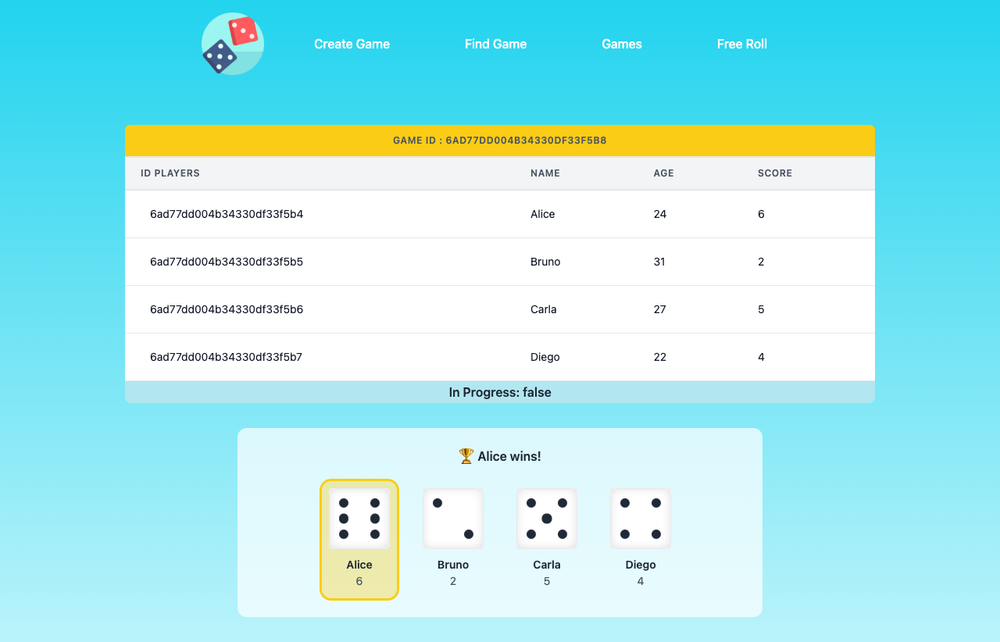
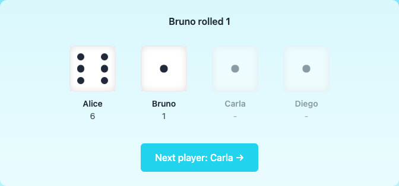
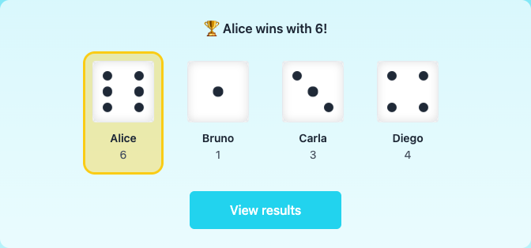
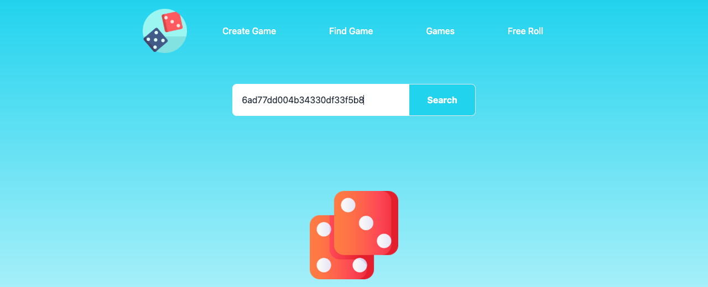
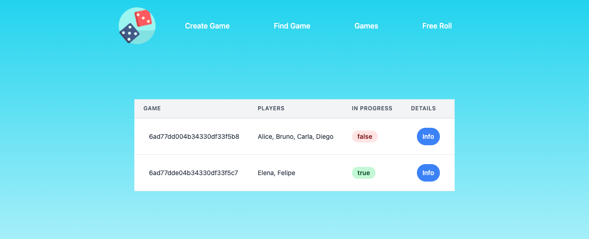
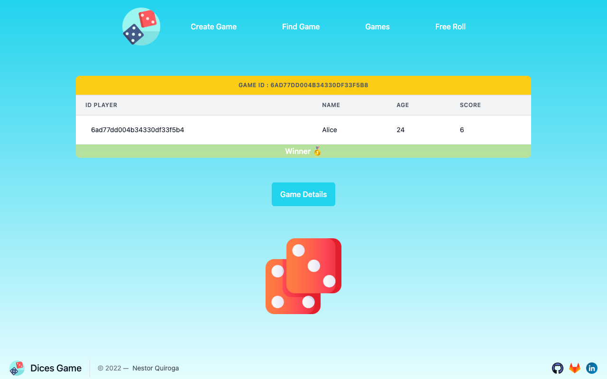
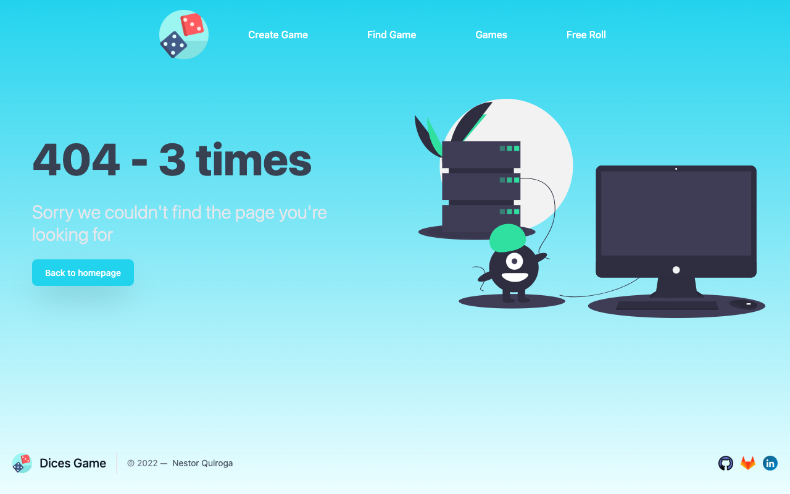

<a id="top"></a>

<h1 align="center">🎲 DiceGame</h1>

<p align="center">
  A dice game for 2 to 5 players with animated 3D dice, built with Node.js, Express, EJS and MongoDB following the MVC pattern.
</p>

<p align="center">
  <a href="https://dice.nesst-tech.online/">
    
  </a>
</p>

<p align="center">
  
  
  
  
  
  
</p>

<p align="center">
  <a href="https://dice.nesst-tech.online/">
    
  </a>
</p>

## Contents

- [Features](#features)
  - [Game modes](#game-modes)
  - [Create a game](#create-a-game)
  - [Turn-based roll](#turn-based-roll)
  - [Free roll](#free-roll)
  - [Find games](#find-games)
  - [Winner and game details](#winner-and-game-details)
  - [Error page](#error-page)
- [How to play](#how-to-play)
- [Routes](#routes)
- [Project structure](#project-structure)
- [Getting started](#getting-started)
- [Deployment](#deployment)
- [Branching model](#branching-model)
- [Background](#background)

---

## Features

### Game modes

| Mode | Players | Saved in the database | Where |
|---|---|---|---|
| **Turn-based game** | 2 to 5 | Yes | **Create Game** menu option |
| **Free roll** | Anyone | No | **Free Roll** menu option |

### Create a game

<p align="center">
  
</p>

- Choose how many players will play (from 2 to 5, three by default); only the fields for the selected players are shown.
- Every visible field is required, and the age is a number.
- The server also limits the number of players to between 2 and 5, so the form can't be bypassed.

### Turn-based roll

Each player takes a turn: press **Roll dice** to spin the 3D die, then **Next player** to pass the turn.

<table>
  <tr>
    <td align="center" width="50%">
      <br>
      <sub><b>1.</b> Alice and Bruno already rolled. The button passes the turn to <b>Carla</b>.</sub>
    </td>
    <td align="center" width="50%">
      <br>
      <sub><b>2.</b> After the last roll, the winner is highlighted: <b>Alice wins with 6</b>.</sub>
    </td>
  </tr>
</table>

How a game works:

| Step | What happens |
|---|---|
| First roll | The server rolls all the dice in a single request and saves the game as played |
| Each turn | The current player's die spins and lands on their value |
| Values | Every player gets a different number from 1 to 6, so there is always one winner |
| Last turn | The highest number wins and **View results** opens the played game |

- The values come from the server, so they can't be changed from the browser.
- When the system's *reduce motion* setting is on, the dice change face without spinning.

### Free roll

<table>
  <tr>
    <td width="300"></td>
    <td>
      <ul>
        <li>A single 3D die: press <b>Roll dice</b> and get a number from 1 to 6.</li>
        <li>Roll as many times as you want with <b>Roll again</b>.</li>
        <li>The value is generated in the browser: there are no requests to the server and nothing is saved in the database.</li>
      </ul>
    </td>
  </tr>
</table>

<p align="center">
  
</p>

### Find games

<table>
  <tr>
    <td align="center" width="50%">
      <br>
      <sub><b>Find by ID:</b> paste a game's unique identifier to open its details.</sub>
    </td>
    <td align="center" width="50%">
      <br>
      <sub><b>All games:</b> every game with its players, status and a link to its details.</sub>
    </td>
  </tr>
</table>

### Winner and game details

<p align="center">
  
</p>

- A played game shows each player's score, the dice on their final values and the winner highlighted.
- **View Winner** opens the winner's details, and **Delete Game** removes the game from the database.

### Error page

<p align="center">
  
</p>

Any route that doesn't exist shows a 404 page with a link back to the homepage.

---

## How to play

| Step | Action |
|---|---|
| 1 | Open **Create Game**, choose the number of players and fill in their names and ages |
| 2 | Each player presses **Roll dice** on their turn |
| 3 | Press **Next player** to pass the turn |
| 4 | The highest number wins. Press **View results** to see the played game |

Just want a number? Open **Free Roll** and roll the die.

## Routes

| Method | Route | What it does |
|---|---|---|
| `GET` | `/` | Homepage |
| `GET` | `/createGame` | Form to create a game |
| `POST` | `/createGame` | Creates a game with 2 to 5 players |
| `GET` | `/findGame` | Search by game ID |
| `GET` | `/findGame/:id` | Game details |
| `PUT` | `/startGame/:id` | Rolls the dice and saves the result; returns `scores` and `winnerIndex` |
| `GET` | `/winnerGame/:id` | Winner of a game |
| `GET` | `/deleteGame/:id` | Deletes a game |
| `GET` | `/games` | All games |
| `GET` | `/freeRoll` | Free roll mode (no database) |

## Project structure

```
├── app.js                      # Express app, routes and MongoDB connection
├── bin/www                     # Local HTTP server
├── netlify.toml                # Netlify build, redirects and function settings
├── netlify/functions/
│   └── server.js               # Express app wrapped as a Netlify Function
├── docs/images/                # README screenshots
├── models/
│   ├── game.js                 # Game: players, status and winner
│   └── player.js               # Player: name, age and score
├── controllers/                # One controller per route (create, find, start, winner, delete, games, free roll)
├── routes/                     # Express routers
├── views/
│   ├── components/
│   │   ├── header.ejs / footer.ejs
│   │   ├── diceStage.ejs       # Turn-based dice row
│   │   └── dieCube.ejs         # Reusable 3D die
│   └── *.ejs                   # Pages
└── public/
    ├── styles.css              # Tailwind build
    ├── layout.css              # Full-height page layout
    ├── dice.css                # 3D dice and roll animation
    └── javascripts/app.js      # Dice values generator
```

## Getting started

You need [Node.js](https://nodejs.org/) and a [MongoDB Atlas](https://www.mongodb.com/atlas) cluster (the free M0 tier works).

1. Clone the repo

   ```bash
   # HTTPS
   git clone https://github.com/nqs48/DiceGame_ADev.git

   # SSH
   git clone git@github.com:nqs48/DiceGame_ADev.git
   ```

2. Install the dependencies

   ```bash
   npm install
   ```

3. Create a `.env` file in the root directory with your connection string (it is ignored by git)

   ```bash
   MONGODB_URI=mongodb+srv://<user>:<password>@<cluster>.mongodb.net/<database>?retryWrites=true&w=majority
   ```

4. Run the project

   ```bash
   npm start          # or: npm run n-start (restarts on file changes)
   ```

   Then open [http://localhost:3000](http://localhost:3000).

## Deployment

The site runs on **Netlify**: static files are served by its CDN and every other route is handled by the Express app as a Netlify Function (see `netlify.toml`).

- Set the `MONGODB_URI` environment variable in *Project configuration → Environment variables*.
- In MongoDB Atlas, allow access from `0.0.0.0/0`, since Netlify Functions don't have fixed IPs.
- To reproduce the Netlify environment locally (Node 20 or newer): `npx netlify-cli dev`.

## Branching model

This repository follows **Git Flow**:

| Branch | Created from | Merged into | Purpose |
|---|---|---|---|
| `main` | — | — | Production (deployed site) |
| `develop` | `main` | `main` | Integration of finished work |
| `feature/*`, `docs/*` | `develop` | `develop` | New features and documentation |
| `release/x.y.z` | `develop` | `main` and `develop` | Release preparation, tagged `vX.Y.Z` |
| `hotfix/*` | `main` | `main` and `develop` | Urgent production fixes |

Commits follow [Conventional Commits](https://www.conventionalcommits.org/).

---

## Background

This project started as a REST API practice of the Sofka Training Campus: a three-player dice game with Node.js, Express and MongoDB, separating views, controllers and models. It was first deployed on Heroku and later moved to Netlify, adding the turn-based 3D dice, games from 2 to 5 players and the free roll mode.

## Built with

- [Node.js](https://nodejs.org/) & [Express](https://expressjs.com/)
- [EJS](https://ejs.co/) templates
- [MongoDB Atlas](https://www.mongodb.com/atlas) with [Mongoose](https://mongoosejs.com/)
- [Tailwind CSS](https://tailwindcss.com/) and CSS 3D transforms for the dice
- [Netlify](https://www.netlify.com/) Functions with [serverless-http](https://github.com/dougmoscrop/serverless-http)
- [Git](https://git-scm.com/)

## License

Distributed under the MIT License. See `LICENSE` for more information.

## Author

**Nestor Quiroga Suárez**: [LinkedIn](https://www.linkedin.com/in/nqs48/)

<p align="center">
  <a href="https://dice.nesst-tech.online/"><strong>▶ Play DiceGame</strong></a>
  ·
  <a href="#top">Back to top ↑</a>
</p>
