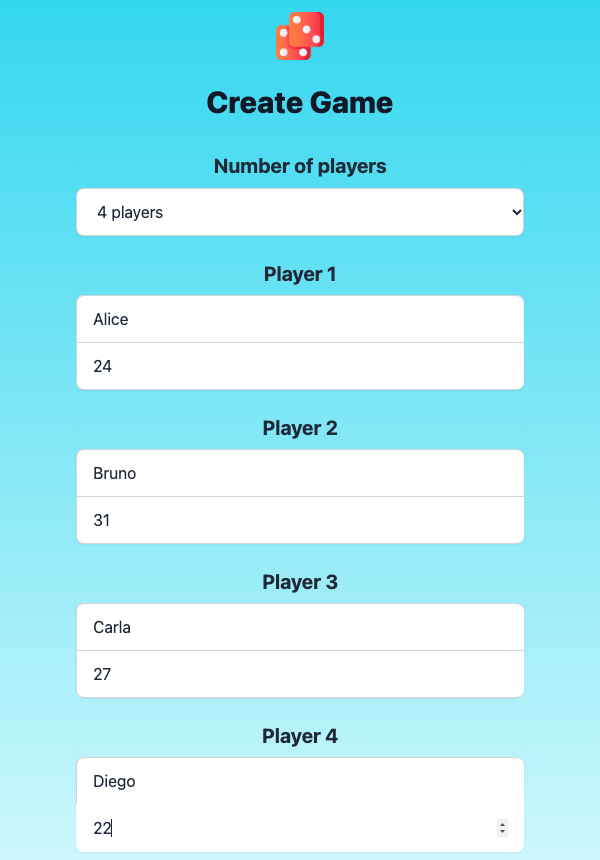
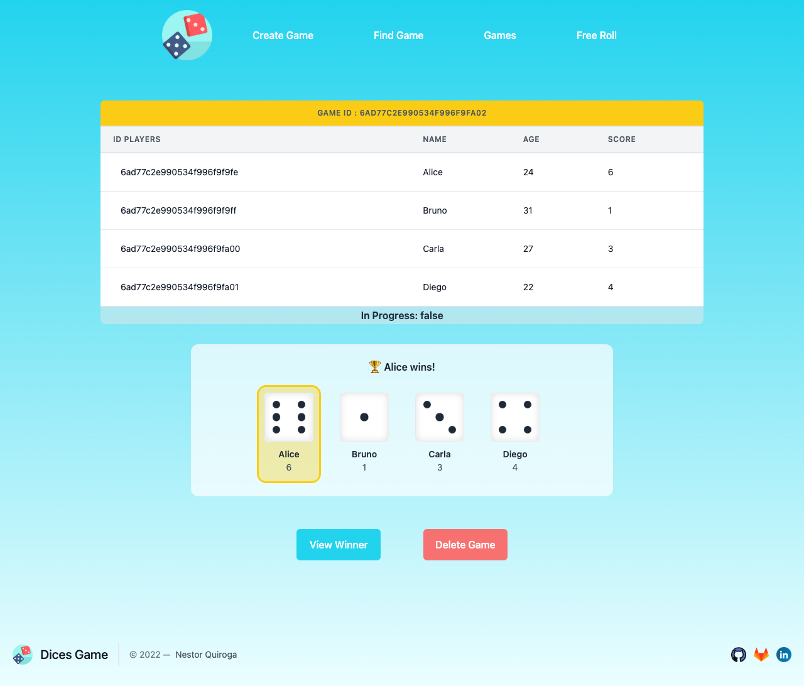
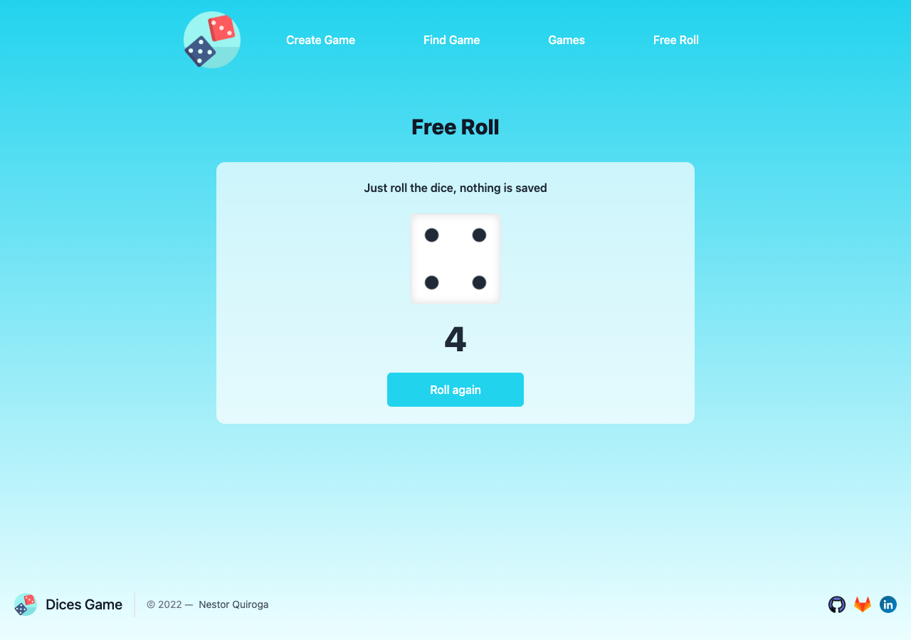
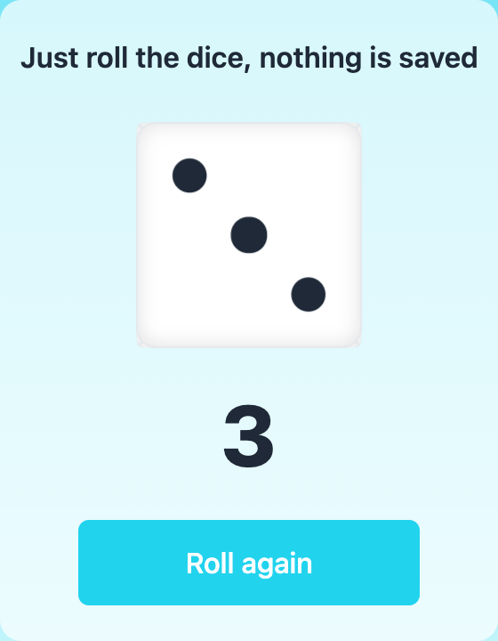

# DiceGame-API_REST
Demo project where a separation of responsibilities is united using the concepts of:  - Template (view), Logic (controller) , Data (Model). Rest-oriented system.

---

<!-- ABOUT THE PROJECT -->
## About The Project

Responsive design of a dynamic web page, where you can play a game of dice with your friends or family obtaining an undisputed winner.

- Key frontend and backend concepts
- Rest API with Nodejs
- API consumption from the frontend

### Game Modes

- **Turn-based game:** from 2 to 5 players, each one rolls an animated 3D die in turn. The game is saved in the database.
- **Free roll:** just roll a die and get a number from 1 to 6. Nothing is saved.

### [https://dice.nesst-tech.online/](https://dice.nesst-tech.online/)


---

# PROJECT REVIEW:

### UI Index Web Page

Responsive design of a dynamic web page


---

## CREATE GAME:

### Form to create game

Choose how many players will play (from 2 to 5, three by default); only the fields for the selected players are shown.



### Form Validation

Form validation with required fields.


---

## FIND GAMES:

### Find By ID

Filter to find games from their unique identifier.


### Find All Games

Method to find all available games in the database.


### Can't Find All Games

View display when there are no games in the database.


### Can't Find By ID

View display when game is not found by identifier.


---

## DETAILS GAME:

### Turn-based roll (inProgress: True)

Each player takes a turn: press **Roll dice** to spin the 3D die, then **Next player** to pass the turn. The values are generated by the server in a single request, so they cannot be changed from the browser.


When the last player rolls, the winner is highlighted.


### State of the game inProgress: False

If the game has been played, the dice show the final values and the winner.




### View Winner

See the details of the winner gives game.


---

## FREE ROLL:

### Roll a single die

Available at `/freeRoll` from the **Free Roll** menu option. Roll the die as many times as you want and get a number from 1 to 6. The value is generated in the browser and nothing is saved in the database.






---

## DELETE GAME:

### Delete some game

Deleting a game that has been played or not.


---

## ERROR UI:

### Generic View for Not Found

If a route is not found automatically an error view is displayed.


## Built With

This section contains the platforms that were used for the project.

* [Node js](https://nodejs.org/es/)
* [Git](https://git-scm.com/)
* [MongoDB Atlas](https://www.mongodb.com/atlas)
* [Netlify](https://www.netlify.com/) (Express app deployed as a Netlify Function)


### Installation

Install each one the pieces of software previously mentioned.


1. Clone the repo

- HTTPS
   ```
   $ git clone https://github.com/nqs48/DiceGame_ADev.git
   ```


- SSH
   ```
   $ git clone git@github.com:nqs48/DiceGame_ADev.git
   ```


2. Open the project with VisualStudio Code (In the root proyect directory)

   ```
   $ open .
   ```
   
3. Install the node package (In the root proyect directory)

   ```
   $ npm install
   ```
   
4. Create a `.env` file in the root directory with the connection string of your MongoDB cluster (it is ignored by git)

   ```
   MONGODB_URI=mongodb+srv://<Your-User>:<Your-Password>@<Your-Cluster>.mongodb.net/<Your-DataBase>?retryWrites=true&w=majority
   ```

   On Netlify, set the same `MONGODB_URI` variable in *Project configuration → Environment variables*.
   
5. Run the proyect (In the root proyect directory)

   ```
   $ npm run start
   ```

6. Open the localhost port 3000 in your preference browser

   ```
   http://localhost:3000/
   
   ```

---

<!-- LICENSE -->
## License

Distributed under the MIT License. See `LICENSE.txt` for more information.

---

<!-- CONTACT -->
## Collaborators
```
Nestor Quiroga Suarez
Jr. Software Developer
```
- LinkedIn => [Nestor Quiroga Suárez](https://www.linkedin.com/in/nqs48/)


Project Link: [https://dice.nesst-tech.online/](https://dice.nesst-tech.online/)

<p align="right">(<a href="#top">back to top</a>)</p>
